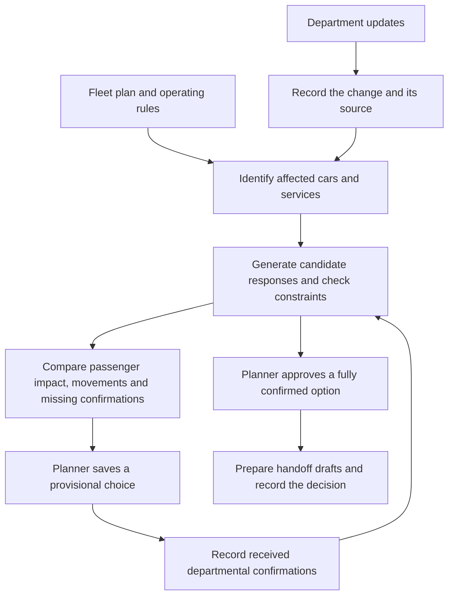

# Sleeper Operations Decision Support

A local decision workspace for European Sleeper's operations team. It brings the fleet plan, an operational change, candidate responses, departmental confirmations, and the resulting decision into one place.

The goal is to reduce the time and mental effort needed to choose a workable action and coordinate it across departments. The same case workflow supports different operational situations, with checks and response options tailored to each.

## The workflow



## What the first version does

- Imports the supplied fleet and running workbooks without changing them.
- Reads fleet codes and cell fills, including coloured empty cells that carry availability restrictions.
- Shows the daily plan and source-cell references for Prague, Paris, and Milan.
- Records cases for car availability, maintenance changes, capacity changes, service delays, resource availability, formation changes, workshop releases, and other operational requests.
- Builds candidate replacement responses from the imported fleet for unavailable-car and maintenance cases. Other case types provide structured action proposals and the operational confirmations needed to evaluate them.
- Lets a planner propose another action and assess it through the same evidence, confirmation, and decision workflow.
- Shows passed, pending, and failed checks for each option. Missing operational information stays pending.
- Records departmental messages and explicit, human-entered confirmations against an option.
- Saves provisional decisions and blocks approval when a required check is pending or failed.
- Stores cases and the decision history in a local SQLite database.
- Prepares departmental handoff drafts for manual review and sharing.

This is a rule-based decision-support prototype. It does not use an external language model, read email automatically, or send messages to train operators.

## Supported case types

| Case | Decision support |
| --- | --- |
| Car unavailable | Compare actual candidate cars and reduced formation; check compatibility, availability and remaining commitments |
| Maintenance change | Assess the effect of a maintenance or release change and candidate cover arrangements |
| Capacity change | Assess capacity, product and booking recovery proposals using explicit demand and compartment confirmations |
| Service delay | Compare revised preparation/departure arrangements, alternative formation and passenger recovery |
| Resource unavailable | Evaluate an alternative operating window or location, revised movement, or deferral of a nonessential movement |
| Formation change | Assess a proposed change, retain the existing formation, or stage the change |
| Workshop release | Compare collection on a scheduled service, a dedicated transport, or holding until a suitable collection slot |
| Other request | Add a planner-proposed response with an explicit description, consequences and required confirmations |

These are decision workflows, not a full network optimiser. Template proposals are not an assertion that a movement is executable. The planner sees the missing inputs and records evidence before approval.

## Requirements

- Python 3.10 or later.
- The package in `requirements.txt`.
- Authorised local access to the two operational workbooks.
- A current browser.

## Run locally

Clone this repository and open its directory:

```bash
git clone https://github.com/varundevB/european-sleepers-ops-decision-support.git
cd european-sleepers-ops-decision-support
python3 -m venv .venv
```

Activate the environment on macOS or Linux:

```bash
source .venv/bin/activate
```

On Windows PowerShell:

```powershell
.venv\Scripts\Activate.ps1
```

Install the dependency and start the app. Replace the two example paths with the files you are authorised to use:

```bash
python -m pip install -r requirements.txt
python app.py --fleet "/path/to/Fleetmanagement-2026sandbox.xlsx" --running "/path/to/Weekinfo details per train.xlsx"
```

Open **http://127.0.0.1:8766**. The server binds to your computer's loopback address by default. Keep that default for this prototype, which has no multi-user authentication.

The imported records and saved decisions remain in the local `var/` directory. The source workbooks are read-only inputs. See `python app.py --help` for the supported startup options.

After the first import, `python app.py` reopens the saved local workspace without requiring the file paths again. To replace the imported snapshot, run the command with the workbook paths and `--reimport`. Cases are retained, while prior approvals and operational confirmations require a new review against the refreshed source data.

Alternatively, copy `.env.example` to `.env`, set your local workbook paths, and run `python app.py`. The `.env` file is excluded from Git.

## Try the main flow

1. Open the fleet view and choose **Milan** and **19 October 2026**, a date with populated source data. The workbook is a historical/planning snapshot, not a live service feed.
2. Choose a case type and record an example change. Select an affected car where required. Label test scenarios clearly. Leave the number of affected passengers empty unless it is known; a train's total passenger count does not identify the passengers booked in one car.
3. Compare the generated responses. Open the evidence and pending checks before choosing a provisional response.
4. Record a department's received message. Confirm only the specific facts supported by that message.
5. Revisit the options. An option remains conditional until every required check is satisfied. A failed check cannot be cleared by recording a generic confirmation.
6. Save the decision and review or download the handoff drafts. Refresh the browser to check that the case persists.
7. Try a service delay or resource case. Compare its case-specific proposals, then add another action if the available proposals do not fit the situation.

## Data and interpretation

The workbooks are not distributed in this repository.

| Source | Used for |
| --- | --- |
| `Fleetmanagement-2026sandbox.xlsx` | Daily fleet assignments, owner/type identifiers, movement/product codes, availability fills, notes and passenger totals |
| `Weekinfo details per train.xlsx` | Historical departure/arrival deviations, passenger impacts and incident notes |
| The supplied planning brief | Operating constraints and the planner's workflow |

Important distinctions:

- **Physical car ID and passenger car number are different identifiers.** Product codes in the planning grid do not describe the physical carriage order.
- Capacity is **nominal**, derived from the car type and product code. Booking-level demand, blocked compartments and actual saleable capacity require confirmation.
- The running workbook's departure and arrival fields are **minute deviations**, not scheduled departure or arrival times.
- Daily records and weekly summaries have different meanings. A column labelled as a percentage can contain a passenger count on daily rows.
- The workbooks mix historical observations and future plans. Missing source values must not be interpreted as observed zeroes.
- Existing formula totals and the fleet workbook's `Check` sheet are not used as authoritative constraint checks.
- The data is joined by **line and date**, rather than assuming that row numbers align between files.

## Decision checks and limits

The engine checks what the available data supports, including owner/type country restrictions, product compatibility, car availability, potential allocation conflicts, and formation limits. Each option shows its evidence and unresolved requirements.

The spreadsheets alone do not establish every fact needed to execute a plan. Door orientation, full country approval records, technical release, exact location, occupied compartments, shunting and transfer slots, preparation time, onward commitments, and partner acceptance may need explicit confirmation.

The first version does not parse the free-form physical-order tabs into a verified formation. It shows grid assignments and retains source comments; physical order and passenger car-number mapping need separate evidence.

Messages are stored as evidence. Free text is not silently converted into operational approval. A person records the specific confirmation after reviewing the source communication.

Costs remain unknown when no quote or supported estimate is available. The application does not claim that a proposed response saves a particular amount of money or delay time without the inputs needed to calculate it.

## Repository structure

```text
app.py             Local HTTP API, persistence and static file serving
engine.py          Plan checks and response generation
import_data.py     Read-only workbook import and source normalisation
web/               Browser interface
tests/             Rule and validation checks using synthetic records
requirements.txt   Python dependency
var/               Local database, excluded from Git
```

Run the automated checks with:

```bash
python -m unittest discover -s tests -v
```

## Working together

Keep the operational spreadsheets, databases, generated handoffs, credentials, and local exports outside Git. The supplied `.gitignore` excludes common data formats and the local state directory. Review the staged files before committing.

Source workbook corrections should happen through the team's agreed source-data process. A disruption case adds a decision record; it does not rewrite the imported workbook.

Useful next work:

1. Validate each case type, its checks and proposal ranking with the planner using real incidents, including the worked Friday example from the brief.
2. Add a reviewed carriage-order parser and explicit orientation/route-segment data.
3. Connect authorised booking, maintenance, and operator systems so fewer confirmations require manual entry.
4. Measure time to a decision and clarification exchanges against the current workflow.
5. Add multi-user access, authentication, deployment, and reviewed integrations before shared production use.

## Ownership and use

This repository contains application code, not a licence to redistribute European Sleeper's operational material. Follow the hackathon's data, confidentiality, ownership, and submission agreements. No open-source licence is implied by publishing the code.
